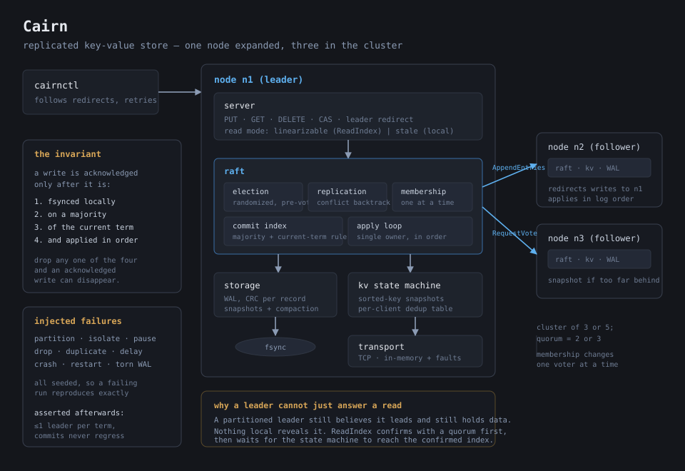
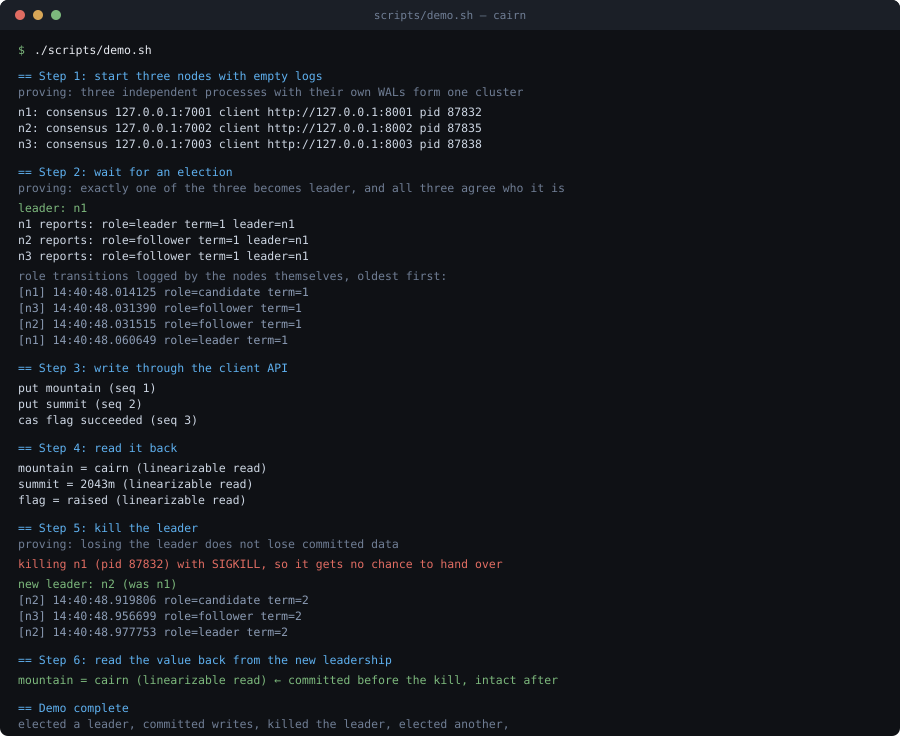

# 🗿 Cairn

*A replicated key-value store that implements Raft rather than importing it: consensus, the write-ahead log, snapshots, and linearizable reads, with a fault injector built to break all four.*



A cairn is a stack of stones left to mark a route for whoever comes next. The name is the point of the project: the interesting part of a distributed store is not that it holds data, it is that it keeps holding the same data after a machine dies mid-write.

Cairn is a 3-to-5 node replicated key-value store in **7,214 lines of Go**, backed by **5,723 lines of tests** — **157 tests** across eight packages, all passing under `-race` on five consecutive runs. It implements leader election, log replication with conflict backtracking, a binary write-ahead log with per-record checksums, crash-safe snapshots with log compaction, linearizable reads via ReadIndex, one-at-a-time membership changes, and check-quorum leader step-down. The network layer can partition, isolate, pause, drop, duplicate, and delay RPCs on a fixed seed, so a failing run reproduces exactly.

The thing I would point at: **four of the bugs in this repo's history were found by tests, not by reading.** They are recorded as individual commits with the failure that exposed each one, because the fixes are the part I actually learned from. One of them only appeared on the fourth of five consecutive runs.

## ✨ Why I Built It

I could describe Raft before I wrote this. I could not have told you what happens when a follower receives a *redelivered* AppendEntries from two rounds ago — and the answer turns out to be the difference between a correct store and one that silently loses an acknowledged write.

That gap is the whole motivation. Consensus reads as a set of rules, and every rule looks arbitrary until you see the failure it exists to prevent. So the rule I set was: no Raft library, no consensus dependency, no `hashicorp/raft` wrapped in an API. Standard library only, every rule implemented from the paper, and a fault injector whose job is to make me wrong.

The interesting discovery was that **the rules are not independent**. The current-term commit restriction looks like a footnote until you realize it is the only thing stopping a new leader from committing an inherited entry that a future leader will overwrite. Remove it and nothing fails for a long time, and then a committed write vanishes.

## 🔭 What It Does

A client talking to a Cairn cluster gets:

- **Four operations** — `PUT`, `GET`, `DELETE`, and `CAS(key, expected, new)`. Writes are accepted only by the leader; followers return a redirect with the leader's identity rather than answering from their own state.
- **Linearizable reads, and the honest alternative.** `GET` defaults to a ReadIndex barrier: the leader confirms with a quorum that it still leads, then waits for its state machine to reach the confirmed commit index. `?stale=true` opts out and reads local applied state. Both are exposed on purpose — having the weaker mode makes the cost of the stronger one measurable instead of assumed.
- **Writes that mean something when they return.** A `PUT` is acknowledged only after it is fsynced locally, replicated to a majority, committed under the leader's *current* term, and applied in index order. Drop any one of those four and an acknowledged write can disappear.
- **Honest unknowns.** A timed-out write returns "unknown", not "failed" — the entry may still commit under a later leader. Clients retry with the *same* sequence number, and the state machine's per-client dedup table turns a landed retry into a no-op instead of a second write.
- **Survival of a leader killed with SIGKILL.** `scripts/demo.sh` proves it end to end: three nodes elect a leader, commit writes, the leader is killed with no chance to hand over, the survivors elect a new one, and the committed values read back unchanged.
- **Membership changes while running.** Voters can be added and removed one at a time, which is the condition that makes the change safe without joint consensus.
- **A cluster that gives up when it should.** An isolated leader steps down instead of claiming leadership forever and redirecting clients to itself.



## 🧱 How I Built It

Seven packages, each with one job and a boundary the next one is not allowed to cross. The interfaces in `raft/contracts.go` were written and frozen *before* any implementation, so storage, the state machine, and the transport could be built and tested against a fixed contract.

**`raft/` — consensus.** The state machine proper: `election.go` (randomized timeouts, the log-freshness rule, optional pre-vote), `replication.go` (AppendEntries, conflict-term backtracking, commit advancement, check-quorum), `apply.go` (the single-owner apply loop), `readindex.go` (linearizable reads), `membership.go` (one-at-a-time voter changes).

One mutex guards all node state. The rule that keeps that tractable: **no RPC and no disk write happens while the lock is held**, except the two Raft requires to be synchronous — the vote fsync before replying to a RequestVote, and the log fsync that assigns an index. Everything else copies what it needs, releases, and does I/O outside. That is why several methods re-check their own state after reacquiring: the world moves while an RPC is in flight, and a reply from a term you have left must be discarded rather than applied.

**`storage/` — durability.** A real append-only WAL, not serialized JSON. Each record is length-prefixed with a CRC32-Castagnoli over the whole record *including the length field*, so a corrupted length cannot steer the reader to a plausible wrong boundary. Recovery replays from byte zero, stops at the first short record, bad checksum, or non-contiguous index, and physically truncates the file there. A crash mid-write costs you the torn tail and nothing else.

Snapshots are written atomically (temp file, fsync, rename, fsync the parent directory) and only *then* is the log compacted — the reverse order can leave neither the entries nor the state. Compaction itself rewrites surviving entries to a temp file and renames, because an in-place rewrite would interleave two generations of individually-valid records, which nothing downstream could detect.

**`kv/` — the application.** A map with per-command dedup. Two details carry real weight. `Snapshot()` sorts keys before serializing, because Go randomizes map iteration order and two replicas producing different bytes for the same logical state diverges silently. And the dedup table is *inside* the snapshot — leave it out and a restored node re-applies every retry it had already filtered.

**`transport/` — the network, including its failures.** A hand-rolled binary framing (not gob, so the wire format does not shift under a Go upgrade) over pooled TCP connections, plus an in-memory switchboard with partition, isolate, pause, drop, duplicate, and latency injection on a fixed seed. The in-memory transport **round-trips every argument through the real codec** rather than handing the caller's pointer to the handler. Without that, two "nodes" share backing arrays, and a handler that retains an `Entries` slice passes every in-memory test and corrupts state the first time it runs over a socket.

**`clock/` — determinism.** A virtual clock that fires timers in *deadline* order rather than creation order, with a `BlockUntil` rendezvous. Election tests that depend on wall-clock sleeps are a coin flip; this is what makes them repeatable.

**`tests/` — the cluster harness.** Real storage on temp directories, real consensus, real state machine, controllable network. A crashed node is restarted through exactly the same recovery path as a fresh one. Safety properties are checked from a recorded transition history rather than by polling, because two leaders in one term can coexist for a few milliseconds during a partition and polling will not reliably sample that window.

## 🧪 How I Tried to Break It

The fault injector is the part of the project I would defend hardest, because a consensus implementation that has only been run on a healthy network has not been tested at all.

| Scenario | What it must prove |
|---|---|
| Leader killed after a write is acknowledged | The committed value survives and is readable under the next leader |
| Leader killed *before* majority replication | The write is reported unknown, never as success |
| Minority partition accepts a write | It must refuse; the ghost value must exist nowhere after healing |
| Leader isolated from the majority | It steps down, and a linearizable read against it fails rather than returning stale data |
| Follower partitioned, then healed | It catches up from wherever its log actually diverged |
| Follower so far behind the log was compacted | It is caught up by InstallSnapshot, not by replay |
| 30% packet loss on a 4-node cluster | Split votes resolve; randomized timeouts are the only reason it terminates |
| 40% duplicate RPC delivery | A redelivered AppendEntries must not truncate acknowledged entries |
| Whole cluster killed and restarted | Every committed key comes back off disk |
| WAL truncated mid-record / CRC byte flipped | Replay stops at the damage and keeps everything before it |
| Client retries with the same sequence number | The command applies exactly once |

Every run also asserts three global invariants from the recorded history: **at most one leader per term**, **no node's commit index ever moves backwards**, and **application is in order and exactly once** (gaps allowed only where a snapshot install legitimately jumps `lastApplied`).

To check the suite was not passing vacuously, I mutated the current-term commit rule to always pass. `TestLeaderCommitsOnlyCurrentTermByReplicaCount` failed with exactly the right message, which is the evidence that the assertion is load-bearing rather than decorative.

## 📊 Benchmarks

Measured on an Apple M4 Pro (14 cores, 48 GB), macOS 26.6.2, Go 1.27.1. Full raw output and reproduction commands are in [`bench/results.md`](bench/results.md) and [`bench/README.md`](bench/README.md).

| Operation | Median | Range over 5 runs | Relative |
|---|---|---|---|
| Write, single node (no replication) | **3.73 ms** | 3.71 – 3.81 ms | 1.00x |
| Write, 3-node replicated | **9.53 ms** | 9.40 – 9.74 ms | 2.55x |
| Write, 5-node replicated | **12.84 ms** | 12.51 – 13.39 ms | 3.44x |
| Linearizable read (ReadIndex) | **2.57 µs** | 2.568 – 2.648 µs | 92x a stale read |
| Stale read (local applied state) | **27.9 ns** | 27.66 – 28.18 ns | 1x |

**A single-node write is one fsync and essentially nothing else.** 3.73 ms against the raw WAL's 3.755 ms for the same work — encoding, commit advancement, and apply all sit below the noise floor of one APFS flush. Every write figure here scales with device flush cost, not with my code.

**That also caps throughput, and more clients do not help.** Single-key write throughput on a 3-node cluster is pinned near **250 writes/sec** by the leader's serial fsync: 14 goroutines give 224/s, 112 goroutines give 242/s. Eight times the offered load buys 1.08x throughput. Meanwhile `BenchmarkWALAppend` with a 256-entry batch reaches **62,693 entries/sec at 8.0 MB/s** — the same ~250 fsyncs/sec, amortized. The fix is group commit, not concurrency, and the 236x gap is the size of the prize.

**Snapshots are the headline storage result.** Reaching the same state (50,000 entries, 10,000 keys, final states verified byte-identical) takes **2.0 ms from a snapshot versus 16.0 ms replaying the log — 7.2x to 9.0x faster** — and occupies 1.36 MiB instead of 8.95 MiB.

**Leader failover, 10 repetitions × 3 runs on a 5-node cluster** with a 150–300 ms election window: minimum 197–211 ms, **median 225–238 ms**, maximum 248–470 ms. The maximum is not a bound and should not be quoted as one: two of three runs contained a single sample above the 300 ms worst-case timeout, caused by a split vote costing a second election round. The honest claim is 200–250 ms usually, occasionally about twice that.

**Write latency under 32 concurrent clients over 6 seconds**, three runs: p50 135 / 140 / 154 ms, p95 203 / 199 / 272 ms, p99 231 / 227 / 333 ms. Run-to-run noise is large — the third run is 17% worse at every percentile with no configuration change — so these are reported as three columns rather than the tidiest one.

**Follower catch-up** by log shipping alone: 2,000 entries in 353–365 ms, about 5,600 entries/sec. **WAL recovery** scales linearly as expected: 1k entries 0.71–0.88 ms, 10k 3.70–3.86 ms, 50k 10.0–10.9 ms.

One operational lesson the numbers forced out: with the correctness suite's aggressive 40 ms heartbeat and 150–300 ms election window, sustained load at 56+ goroutines **unseats healthy leaders**, because the leader fsyncs while holding the node mutex and misses its own heartbeat deadlines. The throughput and percentile figures therefore use the shipped `DefaultConfig` timings. The takeaway is that an election timeout has to be sized against worst-case fsync-under-load, not just network delay — the 3x heartbeat ratio `Config.Validate` enforces is necessary but not sufficient.

These were measured with the in-memory transport and zero injected network latency, so they are Cairn's own costs with network transit removed.

## 📚 What I Learned

**A rule you cannot explain is a rule you will delete.** The current-term commit restriction is the clearest example. It reads like a technicality, and removing it breaks nothing for a long time — until a leader inherits uncommitted entries from a previous term, commits them on replica count, and a later leader overwrites them. Writing the test first, then making it fail by disabling the rule, is what turned it from a memorized clause into something I can argue for.

**"Replicated" and "committed" are not the same word, and conflating them is the easiest way to lose data.** An entry sitting on a follower's disk tells you nothing on its own. It is committed when a majority holds it *and* it belongs to the current leader's term. I had both concepts collapsed into one field in my first sketch of the node struct, and separating them clarified half the subsequent code.

**The hardest bug was not in the algorithm, it was in a map.** The leader's in-flight replication map was written one line after releasing the mutex that guarded every other access to it. No assertion caught it. No test failed. The race detector found it, which taught me more about the value of `-race` than any amount of reading: a lock-discipline violation is invisible to behavioural tests until it corrupts something, and by then the symptom is nowhere near the cause.

**A leader is the worst possible judge of whether it is still the leader.** A partitioned leader has every local indicator of health: it has a log, it has state, it thinks it has followers. Nothing it can inspect locally reveals the problem. I had understood ReadIndex as an optimization over committing a no-op per read; it is not an optimization, it is the only mechanism that can answer the question at all, because the answer does not exist locally.

**Running the suite once tells you almost nothing.** The pre-vote bug — a leader granting a pre-vote and letting a rejoining follower unseat it — appeared on the fourth of five consecutive runs and not before. The root cause is subtle in a satisfying way: a leader never arms its own election timer, so its election deadline sits permanently in the past, and the "have I heard from a leader lately?" heuristic reads as *no* on the one node that is certain the answer is yes. I now treat a distributed-systems test that has passed once as untested.

**Edge cases hide at the boundaries of the quorum arithmetic.** A single-node cluster never elected itself, because the quorum check only ran inside the per-peer goroutines and a single-node cluster has no peers for them to run in. The same mistake was in the ReadIndex leadership confirmation, in the same shape. One-node and two-node clusters are not academic curiosities; they are where the off-by-ones live.

**Determinism in the state machine is a correctness property, not tidiness.** Serializing a Go map without sorting its keys produces a different snapshot on every node for identical logical state. Nothing fails immediately. A follower restored from a leader's snapshot simply diverges, quietly, and the first symptom is a read returning something impossible.

**Shutdown is a state, not an event, and the rest of the system does not get the memo.** A stopped node still answered AppendEntries. Its storage was already closed, so the durable write failed, and the durable write treats failure as unrecoverable — so it panicked. A peer mid-call has no way to know a node has stopped, which means "nobody will ask me after I stop" is never a safe assumption. The node has to decline. I found this from a benchmark harness tearing a cluster down, not from any correctness test, which is its own lesson about where bugs hide.

**The slowest operation determines the architecture, and I had put it in the wrong place.** The benchmarks showed single-key throughput pinned near 250 writes/sec no matter how many clients offered load, while the raw WAL managed 62,693 entries/sec when batched — a 236x gap. The leader fsyncs one entry at a time while holding the node mutex. Worse, under sustained load that fsync makes the leader miss its own heartbeat deadlines and *lose leadership to itself*, which is how I learned that an election timeout has to be sized against worst-case disk latency and not just network delay. Group commit is the obvious fix and I have not implemented it; knowing exactly which line costs the 236x is the part I take from this.

**Writing the interfaces first paid for itself.** Freezing `raft/contracts.go` before any implementation meant storage, the state machine, and the transport could be built independently against a fixed contract — and it surfaced two genuine documentation bugs, because the implementers read the comments literally and found places where the prose promised something the code did not do. The `Apply` contract said "every committed entry" when the consensus layer only ever forwards command entries, which would have led a state machine author to treat a leader's no-op as a corrupt payload.

## ⚖️ What I Do Not Claim

- **This is not production-ready, and the gap is not small.** No authentication, no TLS, no cluster ID (a node from a different cluster would be accepted), no rate limiting, no backpressure on client requests, no observability beyond logs.
- **The redirect hint is a node ID, not a reachable address.** A client cannot follow a 307 without an out-of-band identity-to-address map; `cairnctl` bridges it by polling `/status` across its address list. Publishing peer client addresses in `Status` would fix it properly. This is a design gap I found late and chose to document rather than paper over.
- **Snapshot transfer is single-shot, not chunked.** `InstallSnapshotArgs` carries `Offset` and `Done` fields, but `InstallSnapshotReply` has no acknowledged-offset field, so a leader resuming an interrupted transfer must restart at zero. Fine for the state sizes here; not fine for a large one.
- **Membership changes are one-at-a-time, not joint consensus.** That is a deliberate and sufficient choice, but it means a cluster cannot be resized in a single step.
- **Injected network latency is wall-clock, not virtual.** The fault injector does not share the node's `Clock`, so a test cannot run a cluster on virtual time *and* inject delay. The cluster tests therefore use real time and real timeouts, which is why they take ~14 seconds rather than milliseconds.
- **Reads report a timeout as "unknown".** For a write that is exactly right. For a read it is misleading — a read has no side effect to be uncertain about — and the HTTP layer does not currently distinguish them.
- **I have not run a Jepsen-style external linearizability checker.** The linearizability evidence here is invariant assertions plus read-after-acknowledged-write checks under injected faults, which is weaker than a history-checking tool. I would not claim linearizability on this evidence alone; I would claim the specific properties the tests name.
- **No multi-Raft, no sharding, no range partitioning.** One Raft group, one keyspace.

## 🛠️ Tech Stack

- **Go 1.27**, standard library only. No external dependencies — `go.mod` has no `require` block, which is deliberate: a consensus implementation that imports a consensus library has not implemented consensus.
- **`encoding/binary` + `hash/crc32`** (Castagnoli) for the WAL record format and the RPC wire format, both hand-rolled so neither shifts under a toolchain upgrade.
- **`net` + `bufio`** for the TCP transport, with per-peer connection pooling and a single retry confined to reused sockets.
- **`net/http`** with Go 1.22+ method-and-wildcard routing (`GET /kv/{key}`) for the client API.
- **`sync` + goroutines** with a single documented mutex discipline, verified under `-race`.
- **`testing`** for all 157 tests, including table-driven codec tests, randomized differential tests against reference models, and the multi-node cluster harness.
- **`math/rand/v2`** (PCG) for seeded, reproducible fault injection.
- **Hand-written SVG** for the diagrams, so the documentation has no rendering toolchain to go stale.

## 🚀 Setup

**Prerequisites.** Go 1.22 or newer (developed on 1.27). Nothing else — no database, no broker, no container runtime.

1. **Clone and build.**
   ```sh
   git clone https://github.com/LegendaryPenguin/cairn.git
   cd cairn
   go build ./...
   ```

2. **Run the test suite.** This is the fastest way to see what the project actually does.
   ```sh
   go test -race ./...
   ```
   157 tests, about 17 seconds. The cluster suite in `tests/` is the interesting part: partitions, crashes, restarts, and snapshot catch-up against a real three- and five-node cluster.

3. **Watch a leader die.** The demo is the one-command proof.
   ```sh
   ./scripts/demo.sh
   ```
   Eight steps: start three nodes, wait for an election, write, read it back, `SIGKILL` the leader, watch a new one get elected, read the committed value back unchanged, and write again under the new leadership. Every step prints what it is proving.

4. **Run a cluster to poke at by hand.**
   ```sh
   ./scripts/run-cluster.sh
   ```
   Three nodes on `127.0.0.1:8001-8003`. Then:
   ```sh
   go run ./cmd/cairnctl -addr 127.0.0.1:8001,127.0.0.1:8002,127.0.0.1:8003 put summit 2043m
   go run ./cmd/cairnctl -addr 127.0.0.1:8001 get summit
   go run ./cmd/cairnctl -addr 127.0.0.1:8001 get summit -stale
   go run ./cmd/cairnctl -addr 127.0.0.1:8001 status
   ```
   Kill whichever process is leader and watch `cairnctl` follow the election.

5. **Reproduce the benchmarks.**
   ```sh
   go test -bench . -benchtime 2s ./bench/
   go test -run TestMeasure -v ./bench/
   ```
   See [`bench/README.md`](bench/README.md) for what each one measures.

## 🗺️ Repository Map

| | |
|---|---|
| [`raft/`](raft/) | consensus: elections, replication, commit rules, apply loop, ReadIndex, membership |
| [`raft/contracts.go`](raft/contracts.go) | the interfaces frozen before implementation — start here |
| [`storage/`](storage/) | write-ahead log, crash recovery, snapshots, compaction |
| [`kv/`](kv/) | deterministic state machine, command codec, client dedup |
| [`transport/`](transport/) | wire format, TCP transport, in-memory switchboard with fault injection |
| [`clock/`](clock/) | virtual clock for deterministic timing tests |
| [`server/`](server/) | client API, leader redirect, read modes, HTTP layer |
| [`tests/`](tests/) | cluster harness, invariant auditor, chaos suite |
| [`bench/`](bench/) | latency, throughput, failover, and recovery measurements |
| [`cmd/cairn-node/`](cmd/cairn-node/) | the node binary |
| [`cmd/cairnctl/`](cmd/cairnctl/) | the client CLI |
| [`scripts/`](scripts/) | local cluster and the failover demo |

## 📖 References

Implemented from the Raft paper and dissertation, with the check-quorum and pre-vote mechanisms taken from the dissertation's discussion of practical deployments rather than the extended paper.

- Ongaro & Ousterhout, *In Search of an Understandable Consensus Algorithm* (2014)
- Ongaro, *Consensus: Bridging Theory and Practice* (2014) — §4 membership changes, §6.4 read-only queries, §9.6 pre-vote

Licensed under [MIT](LICENSE).
